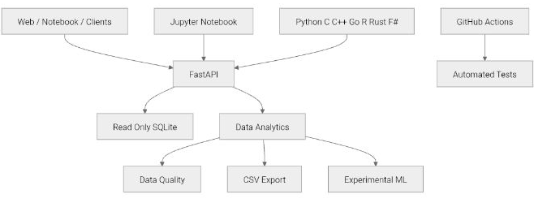
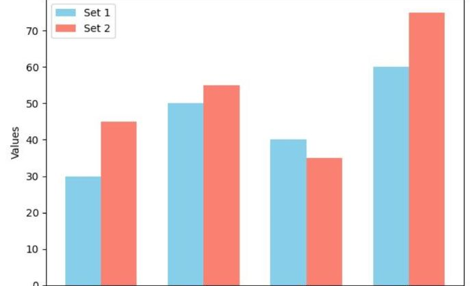
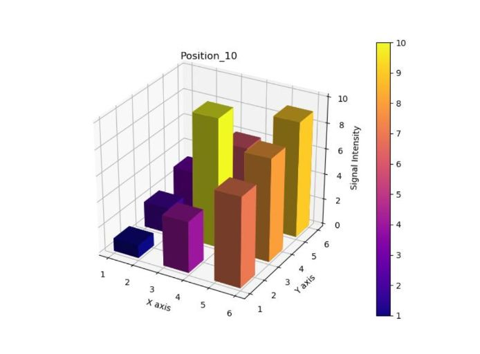
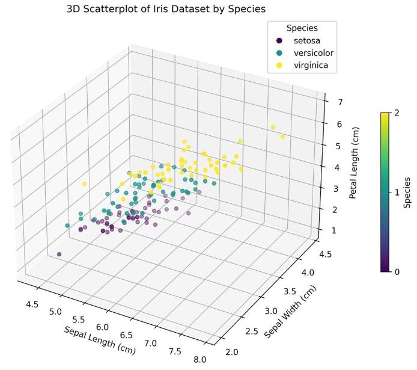
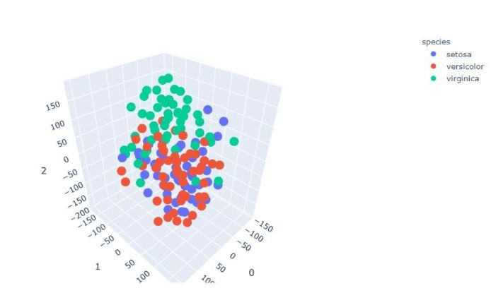
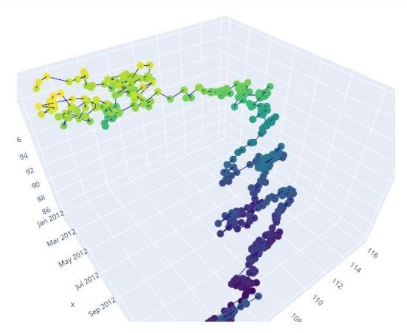
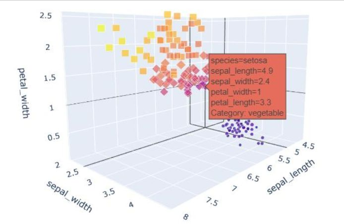
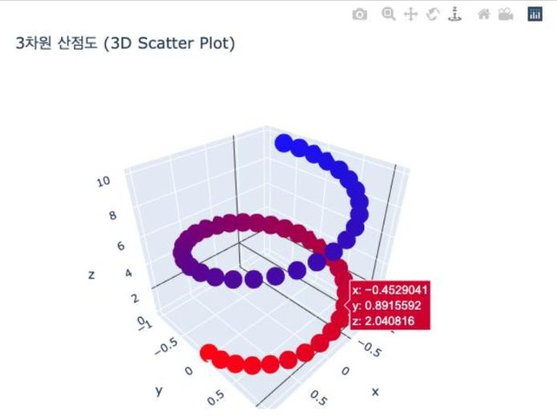
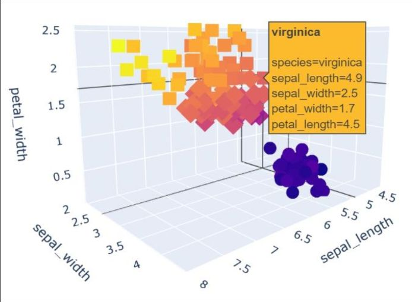

# XchangeFinder — Interactive FX Analytics

**A research-oriented analytics workspace for historical exchange-rate submissions, data quality, API access, visualization, and experimental machine-learning workflows.**

XchangeFinder combines a read-only SQLite data layer, a FastAPI service, a Jupyter Notebook analysis workflow, CSV exports, and starter integrations for multiple programming languages.

> **Data caution:** This repository analyzes historical user/store-submitted exchange-rate records. It is not a live FX quote service, trading system, or financial advice tool. The notebook's demo datasets and the supplied visualization-gallery screenshots are illustrative; they are not live market data.

## Repository overview

- `XchangeFinder_Notebook.ipynb` — Jupyter Notebook for data exploration, comparison, charts, 3D plots, time-series demonstrations, and experimental model evaluation.
- `api.py` — FastAPI read-only analytics service.
- `test_api.py` — API smoke tests.
- `visualization_lab.py` — Standalone chart/visualization generator.
- `dashboard_generator.py` — Generates an interactive HTML dashboard.
- `requirements.txt` — Python dependencies.
- `architecture.svg`, `architecture_visual.png` — Project architecture assets.
- `docs/images/` — Cropped architecture and visualization reference gallery.
- `ML_DATA_SCIENCE_ROADMAP.md` — Data science and ML extension roadmap.
- `python_analyst.py`, `R_analysis.R`, `go_health_client.go` — Language integration examples.
- `C_INTEGRATION.md`, `CPP_INTEGRATION.md`, `RUST_INTEGRATION.md`, `FSHARP_INTEGRATION.md` — Additional integration notes.
- `.github/workflows/ci.yml` — GitHub Actions workflow.

## Architecture



The service exposes historical submission data through a read-only API. The notebook and client examples can consume API results for analysis and export.

## Visualization gallery

The figures below are cropped from the screenshots supplied for this project. They are included as **visual references** to document the range of chart styles and 3D visualization techniques.

### Comparative analytics



### 3D signal and multidimensional plots

| 3D signal intensity | 3D Iris scatter |
|---|---|
|  |  |





### Classification and parametric visualization

| 3D classification | Parametric spiral |
|---|---|
|  |  |



**Important:** Some reference figures use Iris/species labels, generic signal values, or synthetic coordinates. They are not generated from the XchangeFinder exchange-rate database. Use the notebook's FX-specific charts for currency-pair interpretation.

## Features

- FastAPI REST API with interactive Swagger/OpenAPI documentation.
- SQLite read-only access and query-only mode.
- Parameterized SQL filter values and allowlisted table identifiers.
- Historical-rate filtering and pagination.
- Currency-pair summary statistics and Store/User comparison.
- CSV export endpoints.
- Data-quality checks.
- Experimental sequence-order trend estimate endpoint.
- Jupyter analysis notebook with tables, comparison charts, 3D examples, time-series demonstrations, and model evaluation.
- Plotly interactive visualizations and HTML dashboard generation.
- GitHub Actions CI.

## Quick start

### 1. Install dependencies

```bash
python -m pip install -r requirements.txt
```

### 2. Configure the database path

Set `XCHANGEFINDER_DB` to the location of your SQLite database.

**Windows PowerShell**
```powershell
$env:XCHANGEFINDER_DB = "C:\path\to\XchangeFinder.db"
```

**Linux/macOS**
```bash
export XCHANGEFINDER_DB="/path/to/XchangeFinder.db"
```

### 3. Start the API

```bash
uvicorn api:app --reload
```

Open:
- Swagger UI: http://127.0.0.1:8000/docs
- Health check: http://127.0.0.1:8000/health
- Pair analytics: http://127.0.0.1:8000/analytics/pairs
- CSV export: http://127.0.0.1:8000/analytics/export.csv

### 4. Run the notebook

```bash
jupyter notebook XchangeFinder_Notebook.ipynb
```

Start the API first if you want the notebook to request API-backed data. Some notebook sections intentionally use reproducible synthetic demo data.

### 5. Run tests

```bash
pytest -q
```

## API endpoints

| Endpoint | Description |
|---|---|
| `/health` | API and database availability |
| `/tables` | Available tables |
| `/rates` | Historical submissions, filters and pagination |
| `/analytics/pairs` | Pair-grouped statistics |
| `/analytics/compare` | Store/User aggregate comparison |
| `/analytics/data-quality` | Basic data-quality indicators |
| `/analytics/ml/forecast` | Experimental sequence-order trend estimate |
| `/analytics/export.csv` | Historical submissions CSV |
| `/analytics/pairs.csv` | Pair summary CSV |

## Visualization and dashboard generation

Run the standalone visualization lab:

```bash
python visualization_lab.py
```

Generate the interactive HTML dashboard:

```bash
python dashboard_generator.py
```

The generated demo charts use synthetic data unless real API/database observations are explicitly loaded. Treat demo model scores as illustrative only.

## Machine-learning scope and limitations

The experimental trend endpoint and notebook model comparison are not production forecasting systems. The current examples require stronger timestamp validation, sufficient observations, chronological evaluation, leakage controls, and model monitoring before any serious predictive use. Do not use the output as financial advice.

## Security notes

- SQLite access is configured as read-only.
- Query values are passed as SQL parameters.
- Internal SQL table identifiers are selected from a fixed allowlist.
- Password and credential fields are not intended to be exposed by API responses.
- Read-only access is not a substitute for authentication or deployment security.

Before exposing the API publicly, add authentication/authorization, HTTPS, rate limiting, secrets management, logging, monitoring, and deployment hardening. Do not commit database files, credentials, or secrets.

## License and data responsibility

Review the source application's license, dataset ownership, and privacy obligations before redistribution. Add a project license only after confirming that you have the right to license all included code and data.

## Suggested repository settings

**Repository name**

`XchangeFinder-Interactive-FX-Analytics`

**GitHub short description**

`Historical FX submission analytics with FastAPI, SQLite, Jupyter, interactive visualizations, CSV exports, and experimental ML workflows.`

**Suggested topics**

`python`, `jupyter-notebook`, `fastapi`, `sqlite`, `data-analytics`, `data-visualization`, `plotly`, `machine-learning`, `exchange-rates`, `github-actions`
